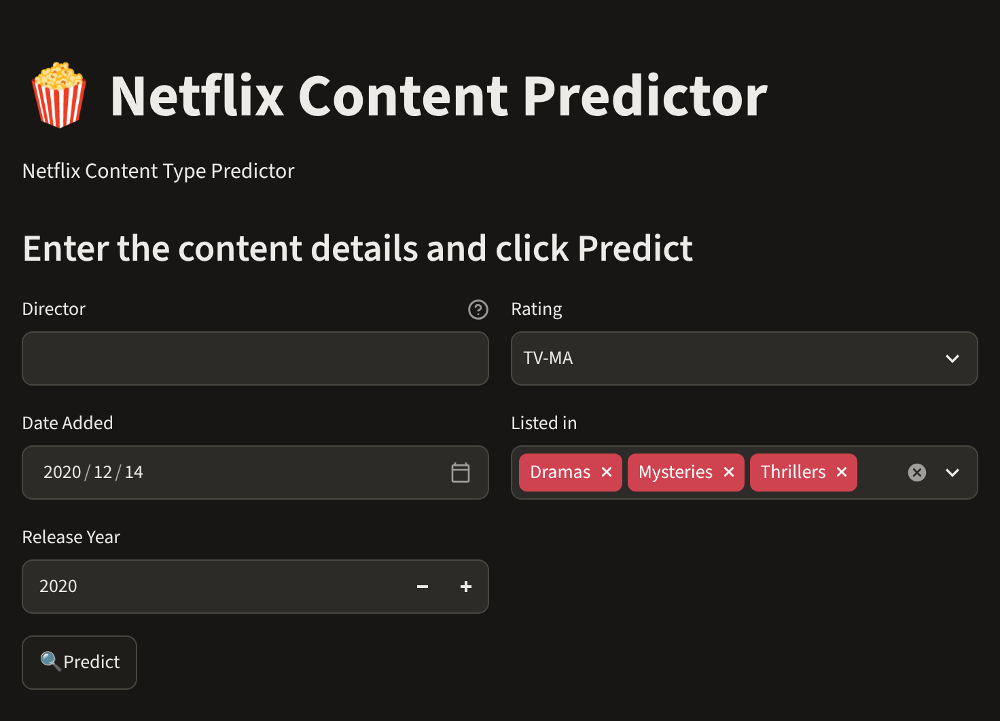
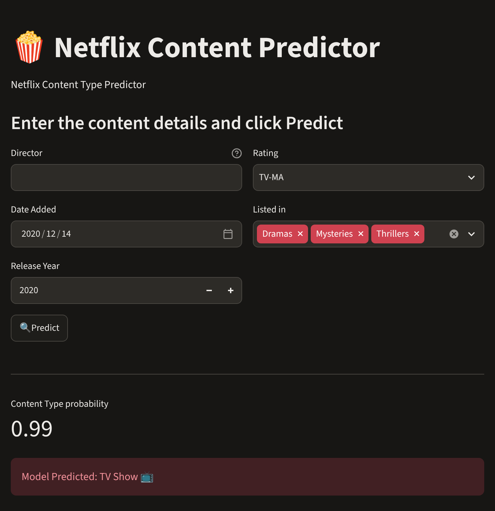
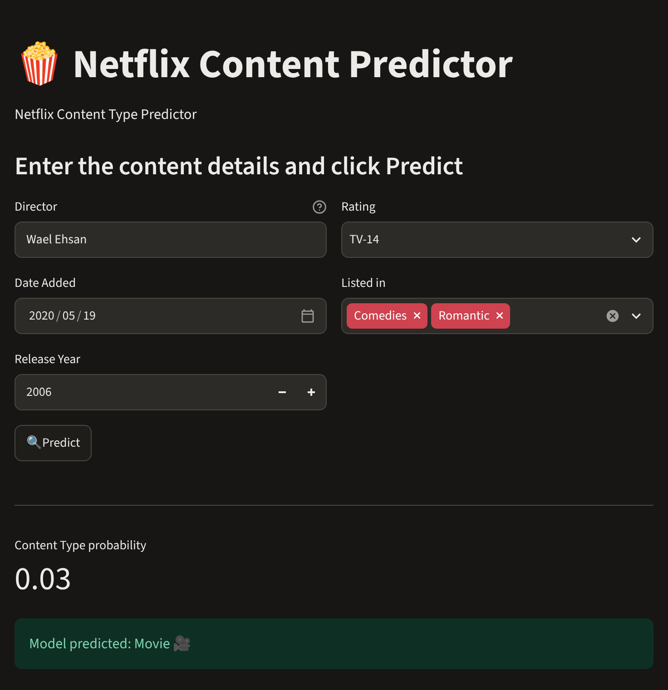
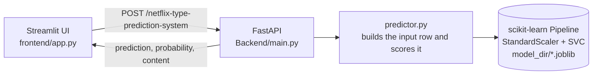

<div align="center">

# 🍿 Netflix Content Type Predictor

**Movie or TV Show? A trained model, a REST API and a web UI in one repo.**


</div>

> [!NOTE]
> This is a learning / portfolio project. It is an independent project and is not affiliated with or endorsed by Netflix. The predictions come from patterns in one dataset and are not an official classification.

---

## Table of contents

- [Overview](#overview)
- [Demo](#demo)
- [How it works](#how-it-works)
- [Project workflow](#project-workflow)
- [Project structure](#project-structure)
- [Dataset](#dataset)
- [Model and results](#model-and-results)
- [Getting started](#getting-started)
- [API reference](#api-reference)
- [Configuration](#configuration)
- [Retraining the model](#retraining-the-model)
- [Running on a server](#running-on-a-server)
- [Limitations](#limitations)
- [Possible next steps](#possible-next-steps)
- [Author](#author)

---

## Overview

The Netflix Content Type Predictor takes five details about a title (director, date added, release year, rating and genres) and estimates whether it is a **Movie** or a **TV Show**.

- **Model** – a `StandardScaler` + `SVC` scikit-learn pipeline, picked from seven classifiers with cross-validation and tuned with a grid search.
- **API** – a FastAPI service that validates input and returns a prediction, a probability and a readable label.
- **UI** – a Streamlit app where you enter the title details and get a result with one click.
- **Notebook** – the full workflow: EDA, pre-processing, baseline, model comparison, hyperparameter tuning and evaluation.

## Demo

Enter the five details, click **Predict**, and the app shows the model's probability that the title is a **TV Show** together with the result. A value close to 1 means TV Show and a value close to 0 means Movie.

<p align="center">
  
</p>

<table>
  <tr>
    <td align="center" width="50%">
      
    </td>
    <td align="center" width="50%">
      
    </td>
  </tr>
  <tr>
    <td align="center"><sub><b>TV Show</b> – probability 0.99</sub></td>
    <td align="center"><sub><b>Movie</b> – probability 0.03</sub></td>
  </tr>
</table>

## How it works



The model is loaded from disk once when the API starts, so each request only pays for the prediction itself. Every prediction is also written to `logs/app.log`.

## Project workflow

Every step of the project, from the raw CSV to the deployed app. Steps 1 to 10 are in the notebook (its section numbers are shown), and steps 11 to 14 turn that work into a running application.

| # | Step | What happens | Where |
| :---: | --- | --- | --- |
| 1 | Load the data | `Dataset.csv` is read: 8,790 titles and 10 columns. | Notebook §2 |
| 2 | Check and clean | There are no empty cells, but `Not Given` marks missing values (29% of directors, 3% of countries). Stray spaces are stripped, 4 duplicate titles are removed (8,786 left) and `show_id` is dropped. | Notebook §3 |
| 3 | Explore the data | The class balance (70% Movie, 30% TV Show), ratings by type and countries by type are plotted. | Notebook §3 |
| 4 | Pre-process | `duration` (it gives the answer away) and `title` are dropped. The label is encoded (Movie = 0, TV Show = 1) and the genres are cleaned. The 44 features are built: `release_year`, `year_added`, `has_director`, one-hot ratings and one-hot genres. | Notebook §4 |
| 5 | Split the data | A stratified train/test split keeps the 70/30 balance in both parts (notebook: 80/20, `training.py`: 85/15, `random_state=42`). | Notebook §4 |
| 6 | Baseline model | A scaled Logistic Regression already reaches 97.4% test accuracy, so the later steps add only a small gain. | Notebook §5 |
| 7 | Compare seven models | 5-fold cross-validation on the training set. Support Vector Classifier has the best F1. | Notebook §6 |
| 8 | Tune the best model | `GridSearchCV` over `C` and `gamma` gives `C=10`, `gamma=0.01`. | Notebook §6 |
| 9 | Retrain and evaluate | The tuned SVC is fitted on the training set and scored on the test set: 97.9% accuracy on the notebook split, with a confusion matrix and ROC curve. | Notebook §7 |
| 10 | Try a prediction | `predict_Movie_TVShow()` takes the 44 feature values and prints the class and the probability. It gives 99.01% TV Show for one test show and 0.14% for one test movie. | Notebook §8 |
| 11 | Move the logic into scripts | `Backend/training.py` repeats the cleaning, feature building, split and final training with the tuned parameters, and saves the pipeline with `joblib`. `Backend/predictor.py` loads it once and turns raw inputs into the 44 features. | `Backend/` |
| 12 | Serve it with an API | FastAPI exposes `/netflix-type-prediction-system` and checks the input fields. | `Backend/main.py` |
| 13 | Build the web app | A Streamlit form sends the details to the API and shows the result. | `frontend/app.py` |
| 14 | Deploy | Both services run in the background on an AWS EC2 instance. | [Running on a server](#running-on-a-server) |

## Project structure

```text
Netflix_Content_Type_Predictor_System/
├── Backend/
│   ├── main.py                 # FastAPI app: /type and /netflix-type-prediction-system
│   ├── predictor.py            # Loads the trained pipeline once and scores requests
│   └── training.py             # Training script – evaluates and saves the model
├── frontend/
│   └── app.py                  # Streamlit user interface
├── Dataset/
│   └── Dataset.csv             # 8,790 rows x 10 columns
├── model_dir/
│   └── netflix-content-type-prediction-model.joblib   # Trained pipeline
├── notebook_files/
│   └── Netflix_content_type_prediction.ipynb          # EDA, model selection and tuning
├── assets/
│   └── screenshots/            # UI screenshots shown in this README
├── env_template.txt            # Template for your local .env file
├── EC2_API_streamlit_commands.txt   # Commands used to run both services on EC2
├── requirements.txt            # Pinned Python dependencies
└── README.md
```

## Dataset

`Dataset/Dataset.csv` holds **8,790 titles** with **10 columns**. There are no empty cells, but missing information is written as `Not Given` (2,588 titles have no director and 287 have no country). The classes are imbalanced: 6,126 Movies and 2,664 TV Shows (about 30% TV Shows).

| Column | Description | Used by the model |
| --- | --- | --- |
| `show_id` | Unique ID of the title | No |
| `type` | `Movie` or `TV Show` – the **label** | Target (`Movie` = 0, `TV Show` = 1) |
| `title` | Title name | No |
| `director` | Director(s), or `Not Given` | Yes – only whether a director exists (`has_director`) |
| `country` | Country of the title | No |
| `date_added` | Date added to Netflix (`M/D/YYYY`) | Yes – only the year (`year_added`) |
| `release_year` | Year the title was released | Yes |
| `rating` | Content rating (14 values, for example `TV-MA`) | Yes – one-hot encoded |
| `duration` | `110 min` or `2 Seasons` | No |
| `listed_in` | Genres, separated by commas | Yes – cleaned, then one-hot encoded |

**Features.** The model sees **44 features**: 3 numbers (`release_year`, `year_added`, `has_director`), 14 rating columns and 27 genre columns. Genre names are cleaned first: the words TV, Movies, Shows, Series and Features are removed, and a few duplicate names are merged (for example `Docuseries` into `Documentaries`) so that a genre name does not give the type away.

> **Duplicate rows.** 4 rows are exact copies of another title (everything except `show_id` matches). They are removed before training, which leaves 8,786 titles (6,123 Movies and 2,663 TV Shows).

> **Columns left out on purpose.** `duration` would give the answer away (`1 Season` is always a TV Show and `110 min` is always a Movie), so a model using it would only be reading the label. `country` is skipped because some labels look unreliable, for example 83% of the titles labelled Pakistan are TV Shows.

## Model and results

**Pipeline:** `StandardScaler` → `SVC` (RBF kernel, `C=10`, `gamma=0.01`, `probability=True`)

**Model selection.** Seven models were compared in the notebook with 5-fold `StratifiedKFold` cross-validation on the training set (80% of the data). Support Vector Classifier scored best on F1 and was chosen:

| Model | CV recall (mean) | CV F1 (mean) |
| --- | :---: | :---: |
| **Support Vector Classifier** | **0.964** | **0.968** |
| Logistic Regression | 0.966 | 0.966 |
| Decision Tree | 0.960 | 0.964 |
| Random Forest | 0.960 | 0.964 |
| Gradient Boosting | 0.964 | 0.964 |
| k-Nearest Neighbours | 0.936 | 0.950 |
| Naive Bayes | 0.992 | 0.674 |

**Tuning.** `GridSearchCV` (5-fold, scored on F1) searched `C` in `[1, 3, 10, 30, 100, 300]` and `gamma` in `[0.001, 0.003, 0.01, 0.03, 0.1]`. The best pair was `C=10`, `gamma=0.01` (CV F1 0.969).

**Held-out test set** (1,318 titles, 15% of the data, stratified split, `random_state=42`) for the saved model – class `TV Show` is the positive class:

| Accuracy | Precision | Recall | F1 |
| :---: | :---: | :---: | :---: |
| 97.6 % | 0.962 | 0.957 | 0.960 |

| | Predicted Movie | Predicted TV Show |
| --- | :---: | :---: |
| **Actual Movie** | 904 | 15 |
| **Actual TV Show** | 17 | 382 |

About 70% of the titles are Movies, so always guessing "Movie" would already score 69.7%. Recall and F1 for the TV Show class are the numbers to watch. Training accuracy is 98.3%, so the gap to the test score is small. The notebook uses a 20% test split (1,758 titles) and reports 97.9% accuracy for the same settings.

## Getting started

### Prerequisites

- Python 3.12 or newer (developed on 3.14) – required by the pinned NumPy and SciPy versions
- Git

### 1. Clone and install

```bash
git clone https://github.com/bharathhottin/Netflix_Content_Type_Predictor_System.git
cd Netflix_Content_Type_Predictor_System

python -m venv .venv
source .venv/bin/activate        # Windows: .venv\Scripts\activate

pip install -r requirements.txt
```

### 2. Create your `.env` file

```bash
cp env_template.txt .env         # Windows: copy env_template.txt .env
```

Open `.env` and set:

- `PROJECT_ROOT` to the **absolute path** of the cloned folder, e.g. `PROJECT_ROOT='/home/you/Netflix_Content_Type_Predictor_System'` (on Windows: `PROJECT_ROOT='C:/Users/you/Netflix_Content_Type_Predictor_System'`).
- `DATASET_DIR=Dataset` – the folder is capitalised in this repo, and on Linux/macOS paths are case-sensitive.
- `TARGET_COL=type` – the label column in the dataset is called `type`.

All other values can stay as they are. See [Configuration](#configuration) for the full list.

### 3. Train the model (optional)

The trained model is already included in the repo, so you can skip this step. To train it again:

```bash
python Backend/training.py
```

See [Retraining the model](#retraining-the-model) for what the script does.

### 4. Start the API

```bash
uvicorn Backend.main:app --reload --port 8000
```

Interactive API docs are now at <http://127.0.0.1:8000/docs>. To check that the API is up, run `curl http://127.0.0.1:8000/type`. It should return `{"status":"ok"}`.

### 5. Start the web app

In a second terminal (with the virtual environment activated):

```bash
streamlit run frontend/app.py
```

Open <http://localhost:8501>. The backend must be running first.

### 6. Try a prediction

Enter the details, click **Predict**, and compare with these two examples, which are based on titles from the dataset:

| | Director | Rating | Date Added | Listed in | Release Year | Result |
| --- | --- | --- | --- | --- | :---: | --- |
| TV Show | *(leave empty)* | TV-MA | 2020/12/14 | Dramas, Mysteries, Thrillers | 2020 | TV Show (0.99) |
| Movie | Wael Ehsan | TV-14 | 2020/05/19 | Comedies, Romantic | 2006 | Movie (0.03) |

You can also call the API directly, as shown in the [API reference](#api-reference).

## API reference

| Method | Endpoint | Description |
| --- | --- | --- |
| `GET` | `/type` | Liveness check – returns `{"status": "ok"}` |
| `POST` | `/netflix-type-prediction-system` | Returns the model's prediction for one title |

**Request**

```bash
curl -X POST http://127.0.0.1:8000/netflix-type-prediction-system \
  -H "Content-Type: application/json" \
  -d '{
        "director": "Not Given", "date_added": "7/31/2020", "release_year": 2020,
        "rating": "TV-PG",
        "listed_in": "British TV Shows, Crime TV Shows, International TV Shows"
      }'
```

**Response**

```json
{
  "prediction": 1,
  "probability": 0.9999999910598766,
  "content": "TV Show 📺"
}
```

| Field | Meaning |
| --- | --- |
| `prediction` | `1` = TV Show, `0` = Movie |
| `probability` | Model's probability that the title is a **TV Show** (not rounded). A Movie therefore has a low value. |
| `content` | `"TV Show 📺"` or `"Movie 🎥"` |

All five fields are required. `release_year` is an integer; `director`, `date_added`, `rating` and `listed_in` are strings. A missing or wrongly typed field returns HTTP `422`.

The API checks types only, so keep these in mind when you call it directly:

- Send `"Not Given"` when a title has no director. An empty string `""` is counted as having a director (the web app already does this for you).
- `date_added` must be `M/D/YYYY`. Any other format returns HTTP `500`.
- `rating` should be one of `G`, `NC-17`, `NR`, `PG`, `PG-13`, `R`, `TV-14`, `TV-G`, `TV-MA`, `TV-PG`, `TV-Y`, `TV-Y7`, `TV-Y7-FV`, `UR`. Any other value is accepted but ignored.

## Configuration

Settings are read from `.env` (never committed – it is listed in `.gitignore`).

| Variable | Used by | Description |
| --- | --- | --- |
| `PROJECT_ROOT` | API, training | Absolute path to the project folder |
| `DATASET_DIR` | training | Dataset folder, relative to `PROJECT_ROOT` (`Dataset`) |
| `DATASET_NAME` | training | Dataset file name (`Dataset.csv`) |
| `MODEL_DIR` | API, training | Where the model is saved / loaded (`model_dir`) |
| `MODEL_NAME` | API, training | Model file name (`netflix-content-type-prediction-model.joblib`) |
| `LOG_DIR` / `LOG_NAME` | API, training | Log folder and file (`logs` / `app.log`) |
| `TARGET_COL` | training | Name of the label column (`type`) |
| `TEST_SIZE` | training | Share of data held out for testing (`0.15`) |
| `RANDOM_STATE` | training | Seed for reproducible splits (`42`) |
| `API_URL` | web app | Full URL of the prediction endpoint (`http://127.0.0.1:8000/netflix-type-prediction-system`) |

## Retraining the model

From the project root, with your `.env` in place:

```bash
python Backend/training.py
```

The script loads the dataset, removes duplicates, builds the 44 features, makes a stratified train/test split, fits the pipeline with the tuned parameters (`C=10`, `gamma=0.01`), logs accuracy / recall / F1 with full classification reports for both sets, and saves the result to `model_dir/`. It does not repeat the grid search. Restart the API afterwards so it picks up the new model.

To explore the full workflow (EDA, model comparison, tuning), open `notebook_files/Netflix_content_type_prediction.ipynb` in Jupyter. The notebook's `CSV_PATH` is set to a path on the author's machine, so point it at `Dataset/Dataset.csv` before running.

## Running on a server

This is how the project runs on an AWS EC2 instance. The steps below are the usual flow; the exact menus depend on your AWS account and the Linux image you pick.

1. **Launch a Linux EC2 instance** and download its key pair.
2. **Open the ports** in the instance's security group: SSH (port `22`, ideally only from your own IP) and `8501` for the web app. Open `8000` only if you want the API itself to be public.
3. **Connect over SSH** using the key pair.
4. **Install Python 3.12 or newer and Git** on the server.
5. **Clone the repo and install the packages:**

   ```bash
   git clone https://github.com/bharathhottin/Netflix_Content_Type_Predictor_System.git
   cd Netflix_Content_Type_Predictor_System
   python3 -m venv .venv
   source .venv/bin/activate
   pip install -r requirements.txt
   ```

6. **Create the `.env` file** (`cp env_template.txt .env`) and set `PROJECT_ROOT` to the folder on the server, `DATASET_DIR=Dataset` and `TARGET_COL=type`. Keep `API_URL` pointing at `127.0.0.1:8000` because both services run on the same machine.
7. **Start both services in the background:**

   ```bash
   nohup uvicorn Backend.main:app --host 0.0.0.0 --port 8000 > uvicorn.log 2>&1 &
   nohup streamlit run frontend/app.py --server.port 8501 --server.address 0.0.0.0 > streamlit.log 2>&1 &
   ```

8. **Check that they are running:**

   ```bash
   tail -f uvicorn.log
   tail -f streamlit.log
   ps aux | grep uvicorn
   ps aux | grep streamlit
   ```

9. **Open the app** at `http://<public-ip-of-the-instance>:8501`.

To update the app later, run `git pull`, stop the two processes (find their numbers with `ps aux | grep`, then `kill <PID>`) and start them again with the commands from step 7. The same commands are saved in `EC2_API_streamlit_commands.txt`. Folder names are case-sensitive on Linux, so write `frontend/app.py` and `Dataset` exactly as shown.

## Limitations

- **The director matters most.** In this data, movies almost always have a director and TV shows almost never do. On the test set the model is right on 99.8% of the titles that follow this pattern (1,251 titles) but only 55.2% of the titles that break it (67 titles: a movie with no director, or a TV show with one). Those titles are about 5% of the data but cause 30 of the 32 mistakes.
- **Time range.** The model was trained on titles added in 2008–2021 and released in 1925–2021. Predictions for dates outside that range are guesses. The app's *Date Added* box starts at today's date, so pick a date from 2008 to 2021.
- **Genre list in the app.** The model knows 27 genre columns, but the app offers 24 options. *Action & Adventure*, *Anime* and *British* cannot be selected, and the app's *Kids* option is sent as *Children & Family*, while the model also has a separate `Kids'` genre.
- **Strict input contract.** The API checks field types but not values such as the rating or the date format; the web app only offers valid ratings and sends the date in the right format.
- **Dataset patterns, not rules.** The model learns what is typical in this dataset (for example, a missing director), not what makes a title a movie or a series. A result near 0.5 should be treated as a guess.

## Possible next steps

- Build the genre options in the app from the model's own columns, and merge the `Kids'` genre into *Children & Family*
- Add value checks to the API schema (Pydantic `Literal` for the rating, a date validator, and treating an empty director as `Not Given`)
- Limit the *Date Added* and *Release Year* inputs to the years the model was trained on
- Replace `SVC(probability=True)`, which scikit-learn 1.9 marks as deprecated, with `CalibratedClassifierCV`
- Add unit tests for the API and CI via GitHub Actions
- Containerise the API and UI with Docker

## Author

**Bharath Hottin** – [@bharathhottin](https://github.com/bharathhottin)

If you find this project useful, a ⭐ on the repo is appreciated.
